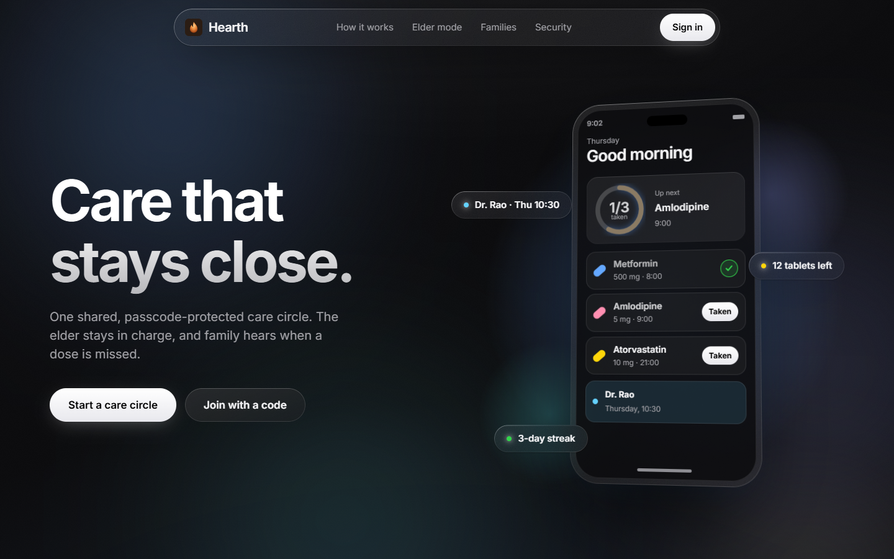
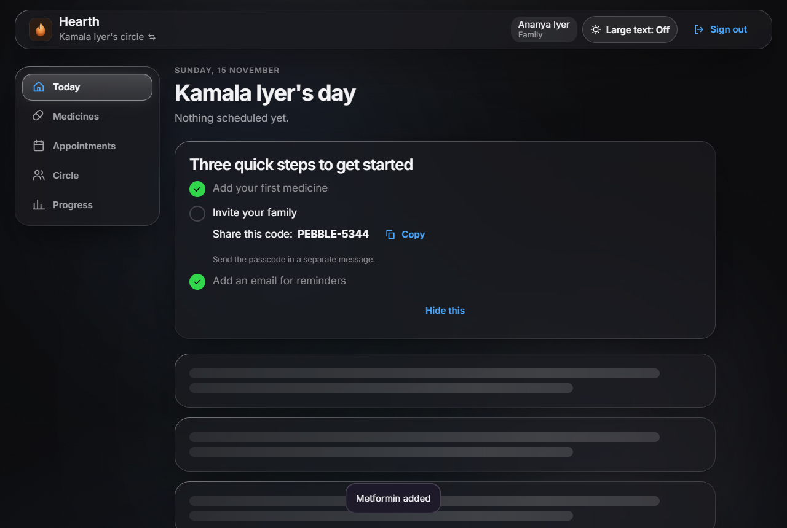
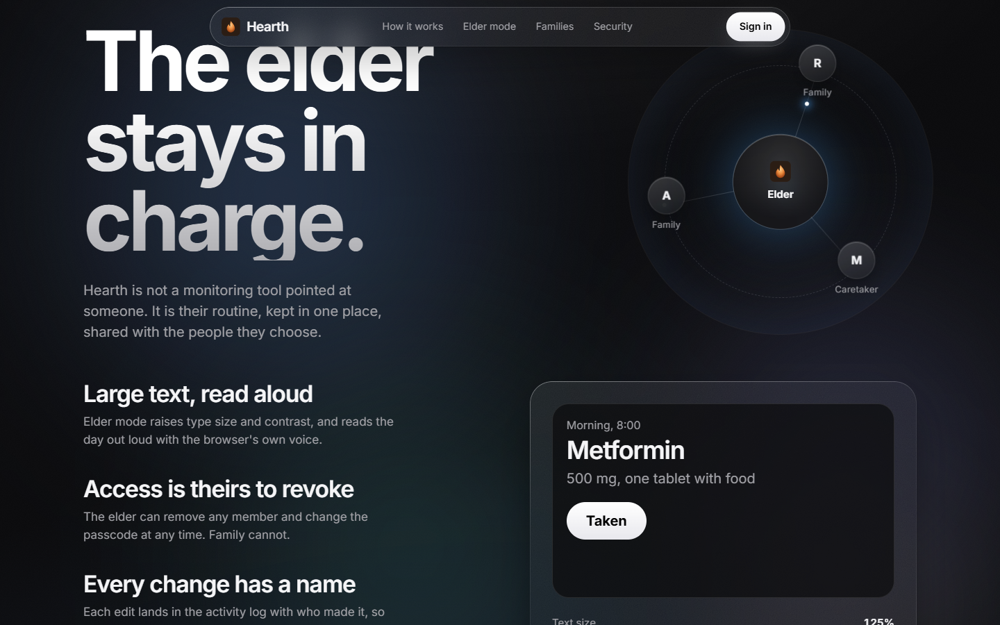
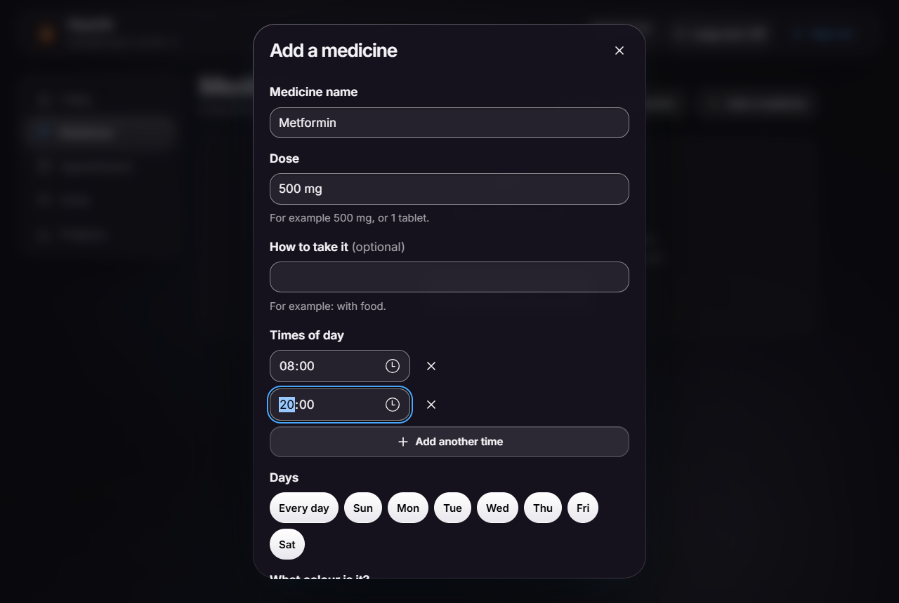
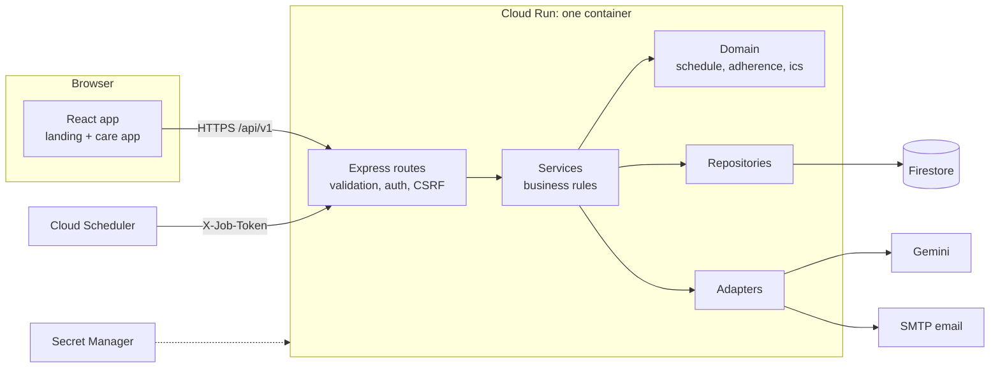

# Hearth: care that stays close

**Hearth is a shared care circle for older adults.** The elder, their family and their caretakers each sign in with their own account, then join one circle with its code and passcode to keep a single medication schedule and appointment calendar together. Doses are marked with one large button. When a dose is missed or a doctor's visit is coming up, the right people get an email automatically.



**Live demo:** https://hearth-b6iw6xpmdq-el.a.run.app · **API contract:** [CONTRACT.md](CONTRACT.md) · **Architecture:** [docs/ARCHITECTURE.md](docs/ARCHITECTURE.md)

> Hearth helps people keep track of medicines and visits. It is not a substitute for professional medical advice.

---

## Why Hearth

Missed doses are common and usually noticed too late. The WHO report *Adherence to Long-Term Therapies* (2003) found that adherence to long-term therapy in developed countries averages around 50%. Families typically coordinate over scattered messages, and many care apps treat the older person as a patient to be monitored.

Hearth is built the other way round. **The elder stays in charge:** their circle, their schedule, their decision. Everyone else is invited in, every change is attributed, and the elder can remove anyone or change the passcode at any time.

## How it meets the brief

| Challenge requirement | How Hearth delivers it | Where |
|---|---|---|
| Shared ecosystem for elders, caretakers and family | A **care circle** with roles (elder, caretaker, family) and a shared view of one profile | `server/src/services/circle.ts` |
| Secure, passcode-based access | **Authentication:** personal accounts (email + password). **Authorization:** a circle's code + passcode grants membership, and every request is checked against that membership and role. scrypt hashing, lockouts, httpOnly sessions | `server/src/services/account.ts`, `server/src/http/middleware.ts` |
| View, add, edit and manage medication schedules | Medicines with multiple daily times, days of week, start/end dates, pause/resume, stock and refill level | `server/src/services/medication.ts`, `web/src/app/medicines/` |
| Track adherence | Today view with **Taken / Skip**, automatic *missed* status, 7/14/30-day progress, per-medicine rates, streaks | `server/src/domain/schedule.ts`, `server/src/domain/adherence.ts` |
| Monitor upcoming doctor appointments | Appointments with reminders, `.ics` export and one-tap **Google Calendar** link | `server/src/services/appointment.ts`, `server/src/domain/ics.ts` |
| Proactive email reminders: missed medications, upcoming doses, appointments | **Cloud Scheduler** triggers a reminder sweep every 5 minutes; emails are deduplicated per recipient and respect each member's preferences. Refill warnings are included. | `server/src/jobs/reminders.ts` |
| Go beyond a basic reminder app | Prescription photo → **Gemini** drafts the schedule → a person reviews and confirms. Weekly plain-language care summary. Activity log. | `server/src/services/insight.ts`, `server/src/adapters/ai/` |
| More accessible | Large-text elder mode, read-aloud, plain-language UI, WCAG 2.2 AA target, full keyboard support | `web/src/app/`, `web/src/styles/tokens.css` |
| Reliable | Exactly-once reminder claims, honest AI fallbacks, health/readiness probes, graceful shutdown, 400+ automated tests | `server/src/repo/`, `server/test/` |
| Collaborative | Shared schedule, attributed activity feed, notification history, invite flow | `web/src/app/circle/` |
| Elder at the centre | Only the elder can remove members or change the passcode; nothing the AI suggests is saved without a person confirming it | `server/src/services/circle.ts` |

## Features

- **Accounts and care circles.** Sign up once; create a circle or join one with its code and passcode. One account can belong to several circles and switch between them. A first-run checklist guides setup.
- **Today.** Doses are grouped into Morning, Afternoon, Evening and Night. Each has large **Taken** and **Skip** buttons with optimistic updates and screen-reader announcements, and **Read aloud** speaks the remaining doses.
- **Medicines.** Schedules with several times a day and selected days, enamel pill colour and shape to match the real tablet, and stock counting that warns when a refill is due.
- **Prescription scan.** Photograph a label and Gemini returns a structured draft. Every item is shown for review, and only the ticked ones are saved.
- **Appointments.** Upcoming and past visits. Each has a calendar file download and a Google Calendar link.
- **Reminders by email.** Covers upcoming doses (15 minutes before), missed doses (after 60 minutes), appointments (at the chosen lead time) and low stock.
- **Progress.** An adherence gauge, a day-by-day chart with an accessible table fallback, per-medicine rates, and a weekly care summary written for family.
- **Activity and notifications.** Shows who changed what and which emails were sent, so nothing changes silently.

| Today | The care circle | Add a medicine |
|---|---|---|
|  |  |  |

## Google Cloud services

| Service | Use in Hearth |
|---|---|
| **Cloud Run** | Hosts the single container: API and web app, HTTPS, autoscaling, graceful SIGTERM shutdown |
| **Firestore** | Stores accounts, circles, members, medicines, dose logs, appointments, activity, notifications and reminder claims; email uniqueness enforced in a transaction (`server/src/repo/firestore.ts`) |
| **Gemini on Vertex AI** (or the Gemini API) | Prescription image reading and weekly care summaries, with JSON-schema output validated by zod (`server/src/adapters/ai/gemini.ts`) |
| **Cloud Scheduler** | Calls `POST /api/v1/jobs/reminders` every 5 minutes with a secret job token |
| **Secret Manager** | Holds the session secret, job token and SMTP password; injected into Cloud Run at deploy time |
| **Cloud Build + Artifact Registry** | Container build and deploy pipeline (`cloudbuild.yaml`) |
| **Cloud Logging** | Structured JSON logs with `severity` and trace-linked request IDs |
| **Google Calendar / Google Fonts** | One-tap "add to calendar" links; Fraunces and Inter typefaces |

## Architecture



Route handlers stay thin. Business rules live in services, pure scheduling logic lives in `domain/`, and every external system sits behind an adapter interface with a local implementation. As a result the whole app runs and is tested with no cloud credentials at all. See [docs/ARCHITECTURE.md](docs/ARCHITECTURE.md).

## Security

- **Authentication**: every person has an account. Passwords (10+ characters) and circle passcodes are hashed with scrypt (random salt) and compared in constant time; a decoy hash keeps response times the same whether or not an email or circle code exists.
- **Authorization**: creating or joining a circle requires a signed-in account. Every circle request re-checks that the account is still a member of the active circle, and management actions (removing members, changing the passcode) are limited to the elder.
- **Brute-force protection**: per-IP limits on sign-in, sign-up and joining, plus lockouts counted across all IPs: 10 failed sign-ins per account per hour and 20 wrong passcodes per circle per hour.
- **Sessions** are signed tokens in `httpOnly`, `Secure`, `SameSite=Lax` cookies, invalidated when the password changes. Removing a member revokes their access to the circle immediately.
- **CSRF**: every state-changing request must carry a custom header that cross-site requests cannot send without a preflight.
- **Input validation**: strict zod schemas reject unknown fields, control characters and bad formats. Bodies are size-capped (100 KB, 7 MB for images).
- **Authorisation**: every query is scoped to the session's circle, so there are no cross-circle object IDs, and member management is restricted to the elder.
- **Headers** via helmet: strict Content-Security-Policy, HSTS, `frame-ancestors 'none'`, `nosniff`, Referrer-Policy and Permissions-Policy.
- **Errors** reach clients only in the contract shape, never as stack traces. Logs redact cookies and tokens.
- **AI safety**: system instructions treat image text and facts as data, outputs must pass schema validation, nothing is saved without human confirmation, and there is a per-circle hourly quota.
- **Supply chain**: lockfile installs, a gitleaks secret scan and `npm audit` in CI, least-privilege workflow permissions, and a non-root container.

## Accessibility

- WCAG 2.2 AA target: semantic landmarks, one `h1` per screen, labelled inputs, visible focus, focus moved to the heading on navigation, and modals with a focus trap and Escape to close.
- **Large-text mode** scales type and raises touch targets from 44 px to 60 px. It is on by default for the elder.
- **Read aloud** uses the browser's speech synthesis. Status is never shown by colour alone, async results are announced through `aria-live`, and charts include a data table.
- `prefers-reduced-motion` turns off the landing page animations and particle canvas.

## Testing

```bash
npm test            # unit + API tests, all workspaces
npm run test:e2e    # Playwright journeys + axe accessibility scans (run `npm run build` first)
npm run lint        # ESLint: TypeScript, React hooks, jsx-a11y
npm run typecheck   # strict TypeScript everywhere
```

| Suite | Files | Tests | Covers |
|---|---|---|---|
| Server (Vitest + Supertest) | 13 | 362 | Domain rules, accounts and sessions, membership authorization, every endpoint, security (CSRF, IDOR, lockouts, headers), AI fallbacks and quota, reminder sweep, config |
| Web (Vitest + Testing Library) | 8 | 50 | API client, time-zone conversion, sign-in and circle list, Today, Medicines, Appointments, landing page |
| End-to-end (Playwright + axe-core) | 1 | 5 × 2 viewports | Sign-up to first dose in a real browser on desktop and mobile; WCAG 2.2 AA scan of every screen; joining with a code; sign-out; large-text mode |

Server statement coverage is about 89% (`npm run test:coverage --workspace server`). CI runs all of these, plus a gitleaks secret scan and a production dependency audit, on every push and pull request.

## Quick start

Needs Node 20 or later. There are no cloud accounts and no keys to set up: by default Hearth uses an in-memory store, a local AI stand-in and a log-only mailer.

```bash
npm ci
npm run dev          # API on :8080, web app on http://localhost:5173
```

For a production-like run: `npm run build && npm start`, then open http://localhost:8080.

### Environment variables

All names are listed in [.env.example](.env.example). The main ones:

| Variable | Purpose |
|---|---|
| `STORE` | `memory` (default) or `firestore` |
| `SESSION_SECRET`, `JOB_TOKEN` | Required in production (Secret Manager on Cloud Run) |
| `GOOGLE_GENAI_USE_VERTEXAI`, `GOOGLE_CLOUD_PROJECT`, `GOOGLE_CLOUD_LOCATION` | Gemini via Vertex AI with the service account; or set `GEMINI_API_KEY` |
| `SMTP_HOST`, `SMTP_PORT`, `SMTP_USER`, `SMTP_PASS`, `MAIL_FROM` | Real email delivery; without them reminders are logged and still shown in the app |
| `APP_URL` | Public URL used in email links |

## Deploy to Cloud Run

```bash
PROJECT_ID=your-project ./scripts/deploy.sh            # region defaults to asia-south1
# optional real email:
SMTP_HOST=smtp.gmail.com SMTP_USER=you@gmail.com SMTP_PASS=app-password PROJECT_ID=your-project ./scripts/deploy.sh
```

The script is idempotent. It enables the required APIs, creates the Firestore database and secrets, grants least-privilege roles, deploys from source, sets `APP_URL`, and creates the Cloud Scheduler reminder job. `cloudbuild.yaml` provides the same pipeline for Cloud Build triggers.

## Project structure

```
server/            Express 5 + TypeScript API
  src/http/        routes, validation schemas, middleware, error shape
  src/services/    business rules (circle, medication, dose, appointment, insight)
  src/domain/      pure logic: dose schedule, adherence, calendar export
  src/repo/        Store interface; Firestore and in-memory implementations
  src/adapters/    Gemini and local AI clients, SMTP and log mailers
  src/jobs/        reminder sweep and email template
  test/            unit, API, security and job tests
web/               React 19 + Vite app
  src/landing/     marketing page (motion, canvas effects)
  src/app/         the care app (Today, Medicines, Appointments, Circle, Progress)
  src/api/         typed API client, mock backend, hooks
  src/styles/      design tokens (material system, elder mode)
fixtures/          contract fixtures (ok / empty / error)
scripts/           deploy and scheduler setup
CONTRACT.md        API contract: single source of truth
```

## Limitations and next steps

- Adherence history is recomputed from the current schedules, so editing a medicine's times changes how past days are counted. A future version will snapshot schedules over time.
- Reminders go out by email. SMS and WhatsApp channels, more interface languages, and an installable offline PWA are the next steps.
- The prescription scan supports reading. It always needs a person to check the result against the original prescription.

## License

MIT. See [LICENSE](LICENSE).
